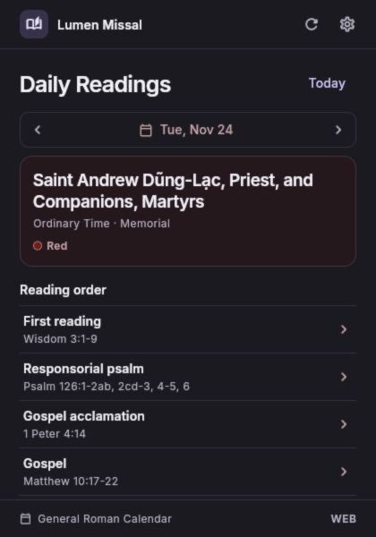
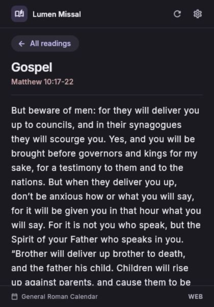

# Lumen Missal

Lumen Missal is a Flutter browser extension for the daily Catholic liturgical readings. Choose a general, national, or diocesan calendar and a Bible translation in Settings.

## Inside the popup

<p>
  
  
</p>

Use the arrows to move one day at a time or select the date to jump anywhere within seven days before or after today. **Today** returns to the current date. Open a citation to read its passage in the selected Bible translation.

The celebration card lists the colours supplied by LitCal. The first recognised colour also tints the card, selected date, and reading accents.

## Readings and storage

[LitCal v5](https://litcal.johnromanodorazio.com/dist/) provides the celebration and reading citations for the selected date. The extension selects the daytime celebration and fetches scripture text from [Bible API](https://bible-api.com/). It keeps the original citations visible. Bible API serves whole verses, including when a citation specifies part of a verse.

The extension caches a day's calendar and successful passages in Drift, scoped to the selected calendar and Bible translation. A failed refresh leaves saved passages available. Settings use browser local storage and app state uses Flutter's ChangeNotifier. Inter is bundled so the popup's typography works offline.

Calendar coverage and scripture coverage depend on the upstream services. If LitCal omits citations, the extension shows the celebration and explains the missing data. If Bible API cannot provide text, the citation remains available in the reading index.

## Build the extension

Use the Flutter and Dart versions specified in [pubspec.yaml](pubspec.yaml).

```sh
flutter pub get
flutter analyze
flutter test
flutter build web --release --wasm
dart compile js web/worker.dart -o build/web/worker.dart.js
```

- **Chrome**. Open `chrome://extensions/`, enable Developer mode, and choose **Load unpacked**. Select the `build/web` directory.
- **Firefox**. Open `about:debugging#/runtime/this-firefox` and choose **Load Temporary Add-on**. Select `build/web/manifest.json`.

To preview the app in a regular browser tab, serve `build/web` over loopback with `python3 -m http.server 8000 --directory build/web`. The browser extension host permissions allow requests to both APIs. When served over HTTP, the upstream services must allow cross-origin requests from the preview origin.

To regenerate Drift and Mockito code after changes to their declarations, run `dart run build_runner build`.

## Release packages

Set `version` in `pubspec.yaml` and tag the release `vMAJOR.MINOR.PATCH` to match its first three components. The release workflow stamps both browser packages with that version. To reproduce the submitted Firefox build from the source archive, use Flutter 3.47.8, run the build commands above, and then stamp the generated manifest with `jq --arg version "$(jq -r .version build/web/version.json)" '.version = $version' build/web/manifest.json > build/manifest.json && mv build/manifest.json build/web/manifest.json`.

GitHub Releases distributes the unlisted, Mozilla-signed Firefox XPI and the Chromium ZIP. Chrome Web Store publishing uses the existing OAuth secrets and the `CHROME_PUBLISHER_ID` repository variable from the store's Publisher Settings. The Chrome Web Store item must already exist.

## Open source

See [CONTRIBUTING.md](CONTRIBUTING.md) and the [MIT License](LICENSE). The bundled Inter font is distributed under its [SIL Open Font License](assets/fonts/OFL.txt).
